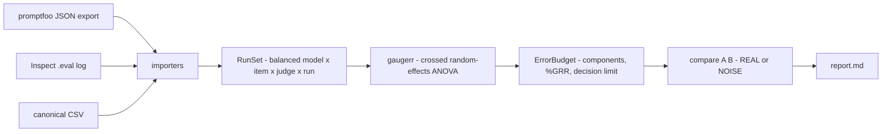

**English** | [简体中文](./README.md)

<div align="center">

<a href="https://github.com/SuperMarioYL/deltagauge">
  
</a>

### Gauge R&R, transplanted into model evaluation: split the score variance into repeatability and reproducibility, and get told whether the delta is noise.

[](https://github.com/SuperMarioYL/deltagauge/actions/workflows/ci.yml)
[](./VERSION)
[](https://www.python.org/)
[](./docs/demo-results.json)
[](./LICENSE)

</div>

---

## Why this exists

Every eval team does the same thing, every day: it makes a decision on a score delta.

Spark Open scores 39. Qwen3.8-Flash-Next scores 40. One point, and it goes into a
model-selection conclusion as if it meant something. But how much of that one point is a
real difference between the models, and how much is contributed by your own measurement
system — one judge being harsher than another, one repeat differing from the next? Nobody
reports that number. The other side of the same problem is sharper still: three LLM judges
could not tell an **agent**'s real memory from a counterfeit one. If the instrument cannot
separate real from fake, what makes its 39 and its 40 comparable?

Quality engineering solved the general form of this decades ago: **gauge R&R**. Measure the
same parts repeatedly with the same gauge, then measure them with several gauges, and split
the variance into repeatability (same gauge, same part) and reproducibility (gauge to gauge).
What comes out is the measurement system's own error budget. DeltaGauge transplants exactly
that into LLM evals: your repeat runs and your multiple judges are already there, and nobody
has ever decomposed their variance.

Once decomposed, the argument becomes a number: a delta below the decision limit is NOISE,
above it is REAL.

## What it gives you

One command, one error budget:

```text
$ deltagauge compare spark-open qwen3.8-flash-next
delta = -1.0    decision limit = ±1.4    verdict: NOISE

 spark-open           39.0
 qwen3.8-flash-next   40.0
```

That `±1.4` is the eval system's own 95% measurement limit: a delta smaller than it cannot
be told apart from the measurement system.

The budget table splits the point across its sources — repeatability, reproducibility, the
item x judge interaction, and part-to-part spread — all in score points:

```text
 variance component                          SD   variance   % of total
 ──────────────────────────────────────────────────────────────────────
 Repeatability (same judge, same item)    0.499      0.249        0.10%
 Reproducibility (judge to judge)         0.436      0.190        0.07%
 Item x judge interaction                 0.201      0.040        0.02%
 Part-to-part (model x item)             16.175    261.629       99.82%
 Total GRR                                0.692      0.479        0.18%
 Total variation                         16.190    262.108      100.00%
%GRR  0.18% of the variance, 4.28% of the study variation
decision limit  ±1.4
```

`Part-to-part` is signal (items genuinely differ in difficulty), so it stays out of GRR and
only enters the `%GRR` denominator. `Total GRR` is the measurement system's own error.

## Architecture

One process, files in and files out. No server, no database.



- `importers/*` — one adapter per export format, each producing canonical `Observation`
  rows. CSV is DeltaGauge's own interchange format; the promptfoo and Inspect adapters know
  where their file keeps the model, the item, the judge, the run and the score. An export
  that carries no repetition is refused with the flag that would fix it, rather than
  decomposed into a fabricated design.
- `model.py` — the canonical schema plus the balance check: a design that is not fully
  crossed (missing cells, duplicated cells, a dimension too small) is rejected with the
  offending cells named.
- `gaugerr.py` — the variance decomposition and the decision limit. The one piece of real math.
- `report.py` / `cli.py` — terminal tables, the Markdown report and the command line entry point.

## Install

Python 3.12+ required. With [uv](https://docs.astral.sh/uv/), install the repo as a global command:

```bash
uv tool install git+https://github.com/SuperMarioYL/deltagauge
deltagauge --help
```

Or run it from a clone:

```bash
git clone https://github.com/SuperMarioYL/deltagauge
cd deltagauge
uv sync
uv run deltagauge --help
```

> The plain `uv tool install deltagauge` from PyPI becomes available with the first proper
> release; until then use the git install above.

## Quickstart

The repo ships a **synthetic** demo dataset (2 models x 103 items x 3 judges x 3 runs = 1,854
observations, fully crossed). From the root of a clone, these five commands are the whole path,
each one under 60 seconds:

```bash
# 1. what did I actually run? describe the design
deltagauge describe
# 2. the error budget of this eval system
deltagauge gauge
# 3. is the one-point delta real?
deltagauge compare spark-open qwen3.8-flash-next
# 4. normalize one export into the canonical run set (the bundled CSV here; your own promptfoo / Inspect export works the same way)
deltagauge ingest examples/spark-open-vs-qwen3.8-flash-next.csv --from csv --out runs.csv
# 5. write the artifact you can paste into a model-selection or procurement writeup
deltagauge report --out report.md
```

With your own data only step 4's input changes:

```bash
deltagauge ingest ./evals.json --from promptfoo --out runs.csv
deltagauge gauge runs.csv
deltagauge compare model-a model-b runs.csv
```

Without a data file, `describe`, `gauge`, `compare` and `report` all work on the bundled demo
data — including when deltagauge is installed as a global command with `uv tool install`:

```text
$ deltagauge describe
spark-open-vs-qwen3.8-flash-next.csv
2 models, 103 items, 3 judges, 3 runs = 1,854 observations, balanced
```

`report.md` holds the same result in a quotable shape: the design table, the error budget
table, one verdict row per model pair, and the estimator's assumptions (the ANOVA model, what
the decision limit means, and that v0.1 does no bootstrap or Bayesian estimation).

> The demo data is **synthetic**: it is generated to carry a one-point mean gap plus known
> judge and run noise, purely to demonstrate the flow. It is not a published benchmark
> result, and 39 and 40 are labels, not real scores.

## Demo

<div align="center">
  
</div>

The recording script is [`docs/demo.tape`](./docs/demo.tape) and re-renders with
`vhs docs/demo.tape`; the exact commands and outputs of this recording are in
[`docs/demo-results.json`](./docs/demo-results.json).

## Usage

| Command | What it does |
| --- | --- |
| `deltagauge describe [RUN_DATA]` | Print the design: models, items, judges, runs and balance |
| `deltagauge gauge [RUN_DATA]` | Print the error budget: four variance components, both `%GRR` forms, the decision limit |
| `deltagauge compare MODEL_A MODEL_B [RUN_DATA]` | Judge the `A - B` delta: delta, decision limit, REAL / NOISE |
| `deltagauge ingest RUN_DATA --from {csv,promptfoo,inspect} --out runs.csv` | Normalize any supported export into the canonical run set |
| `deltagauge report [RUN_DATA] [--out report.md]` | The error budget and every verdict, as Markdown |

`compare` reports `MODEL_A - MODEL_B`, and the rule is a single line:
`|delta| > decision_limit` is REAL, otherwise NOISE.

## Capability and boundaries

| Tool | What it owns | Its relation to DeltaGauge |
| --- | --- | --- |
| promptfoo | Runs the eval and scores a single run | We read its `-o out.json` export; we do not replace it |
| Inspect | Runs the eval and records repeats per epoch | We read its `.eval` log; we do not replace it |
| Leaderboards / aggregation dashboards | Aggregation and ranking (point estimates) | We put an error budget next to a point estimate; we do not change the ranking |
| **DeltaGauge** | Variance decomposition over repeat runs, giving a decision limit and a REAL / NOISE verdict | — |

What v0.1 deliberately does not do: no model calls, no judge implementation, no eval harness
(the repeat runs you already have are the entire input); no web UI or dashboard, just the CLI
and Markdown; no prompt or judge auto-tuning and no score correction; no Slack, Jira or
CI-provider integrations; and classical ANOVA gauge R&R only — no bootstrap, no Bayesian
estimator.

## Configuration

v0.1 has no config file; behavior follows from the input format and the command line flags.

**Canonical CSV** — the header must be `model,item,judge,run,score` (extra columns are ignored,
order does not matter):

```csv
model,item,judge,run,score
spark-open,item-001,judge-a,1,38.4
spark-open,item-001,judge-b,1,39.1
```

**The design has to be decomposable**, or DeltaGauge refuses it and names what is missing:

- at least 2 items, 2 judges and 2 runs (repeatability comes from the run dimension,
  reproducibility from the judge dimension);
- exactly one score per `model × item × judge × run` cell, fully crossed and balanced.

**promptfoo**: the export needs a repetition dimension (`promptfoo eval --repeat n`, n >= 2)
and at least 2 grading providers (a `provider:` on an assertion, or
`defaultTest.options.provider`). An export with a single execution, or a single grading
provider, is refused with the flag that would fix it.

**Inspect**: the log needs epoch repeats (`inspect eval <task> --epochs n`, n >= 2) and every
sample scored by more than one scorer (each key in `sample.scores` is a judge). You can also
point it at a directory, which merges one log per model so that `compare` becomes answerable.

## Pricing

The v0.1 CLI, every importer and the demo data are MIT-licensed, and
`deltagauge report --out report.md` is unrestricted — including commercial use. The paid
surface is the step after it:

- **Hosted eval CI gate** (a v0.2 product direction, not v0.1 code): upload a run bundle and
  get the error budget and the decision limit as a required CI check, with history across
  releases. "This -1.0 move is inside the noise" then stops being a human argument and becomes
  a gate's own conclusion.
- **Wiring support**: help getting the decision limit into procurement sign-off and release
  approval, including mapping what `report.md` concludes onto your own acceptance criteria.

Pricing is an unvalidated hypothesis, not a quote: roughly **$199–499 per team per month**, or
about **$49 per seat** if per-seat wins discovery. The smallest path to a first paid customer:
you produce the conclusion with the free `report.md`, we run the hosted check over the run
bundles of your last 3 releases, and after 30 days you decide whether to continue.

v0.1 contains no hosted service, HTTP API, account or billing code; the paid surface is a v0.2
product decision.

## Roadmap

- **v0.2 — the hosted eval CI gate**: upload a run bundle and turn the error budget and the
  decision limit into a required check on the repository, with history across releases, plus
  paid support for wiring the decision limit into procurement sign-off. This is the only
  settled revenue direction.
- Whether more importers, or bootstrap / Bayesian estimators, come later depends on what real
  users conclude from their own run data. Feedback first; no feature pile-up in advance.

## Limitations

- The bundled demo data is synthetic (see above); this project ships no cross-lab corpus and
  no published benchmark data.
- The decision limit is the **instrument's** own 95% measurement limit (`z × Total GRR`), not
  the standard error of a mean over items. It answers "can this delta be told apart from the
  measurement system", not "are these two models equivalent overall".
- The estimator is a classical crossed random-effects ANOVA (AIAG MSA) and needs a fully
  crossed, balanced design. Bounded scores (0/1, or 1–5) depart from normality at the
  extremes, and v0.1 does not correct for that.
- Variance components that estimate below zero are clamped to zero, the AIAG convention.
- On small designs the reproducibility estimate is noisy, especially with only 2–3 judges;
  read the components `gauge` prints with that precision in mind.

## License

<p align="center"><sub><a href="./LICENSE">MIT</a> © 2026 SuperMarioYL</sub></p>
