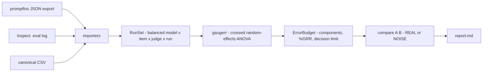
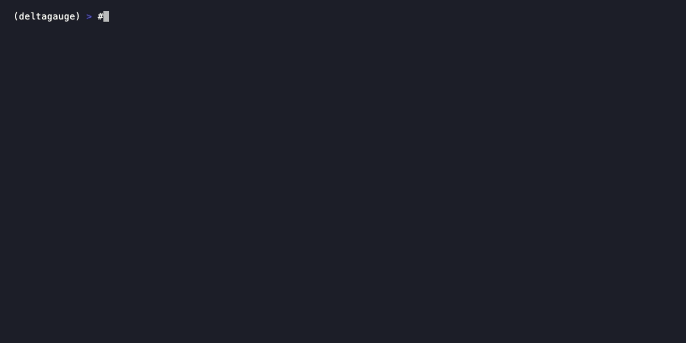

[English](./README.en.md) | **简体中文**

<div align="center">

<a href="https://github.com/SuperMarioYL/deltagauge">
  
</a>

### 把质量工程的 gauge R&R 搬进模型评测：拆出重复性与再现性，直接告诉你这个分差是不是噪声。

[](https://github.com/SuperMarioYL/deltagauge/actions/workflows/ci.yml)
[](./VERSION)
[](https://www.python.org/)
[](./docs/demo-results.json)
[](./LICENSE)
[](https://gitee.com/SuperMarioYL/deltagauge)

</div>

---

## 为什么需要它

评测团队每天都在做同一个动作：拿一个分差做决定。

Spark Open 39，Qwen3.8-Flash-Next 40——一分之差，被当成一次选型依据写进结论。但这一分里有多少是模型之间的真实差距，有多少是你自己的评测系统（judge 的松紧、重复运行之间的抖动）贡献的？没人报这个数。同一个问题的另一面更刺眼：三个 LLM judge 分不清一个 **agent** 的真实记忆与仿造记忆——如果判分器本身分不出真假，那它给出的 39 和 40 又凭什么可比。

质量工程几十年前就解决了这个问题的通用形式：**gauge R&R**。把同一批零件用同一把量具反复测，再换几把量具测，然后把方差拆成重复性（同一把量具、同一个零件）与再现性（量具之间），最后给出这把量具自己的误差预算。DeltaGauge 就是把这件事搬进 LLM 评测：你的重复运行和多个 judge 早就在那里，只是从来没人把它们的方差拆开。

拆开之后，争论变成数字：分差小于判定限就是 NOISE，大于就是 REAL。

## 它给出什么

一条命令，一个误差预算：

```text
$ deltagauge compare spark-open qwen3.8-flash-next
delta = -1.0    decision limit = ±1.4    verdict: NOISE

 spark-open           39.0
 qwen3.8-flash-next   40.0
```

`±1.4` 就是这套评测系统自己的 95% 测量限：小于它的分差，无法与测量系统本身区分。

误差预算表把这一分拆到每个来源（重复性、再现性、item × judge 交互、零件间差异），单位都是分：

```text
 variance component                          SD   variance   % of total
 ──────────────────────────────────────────────────────────────────────
 Repeatability (same judge, same item)    0.499      0.249        0.10%
 Reproducibility (judge to judge)         0.436      0.190        0.07%
 Item x judge interaction                 0.201      0.040        0.02%
 Part-to-part (model x item)             16.175    261.629       99.82%
 Total GRR                                0.692      0.479        0.18%
 Total variation                         16.190    262.108      100.00%
%GRR  0.18% of the variance, 4.28% of the study variation
decision limit  ±1.4
```

`Part-to-part` 是信号（题目本身的难易差异），不计入 GRR，只进 `%GRR` 的分母；`Total GRR` 才是评测系统自己的误差。

## 架构

一个进程，文件进、文件出。没有服务，没有数据库。



- `importers/*` — 每种导出格式一个适配器，统一产出 canonical `Observation`。CSV 是自家交换格式，promptfoo 与 Inspect 的适配器负责在各自文件里找到 model / item / judge / run / score；找不到重复维度的导出会被明确拒绝，并告诉你要补哪个参数。
- `model.py` — canonical schema 加平衡性校验：不是完全交叉的设计（缺 cell、cell 重复、维度不足）会被拒绝，并列出缺了哪些 cell。
- `gaugerr.py` — 方差分解与判定限，唯一的数学部分。
- `report.py` / `cli.py` — 终端表格、Markdown 报告与命令行入口。

## 安装

需要 Python 3.12+。推荐用 [uv](https://docs.astral.sh/uv/) 从仓库直接装成全局命令：

```bash
uv tool install git+https://github.com/SuperMarioYL/deltagauge
deltagauge --help
```

也可以从 clone 出来的仓库里跑：

```bash
git clone https://github.com/SuperMarioYL/deltagauge
cd deltagauge
uv sync
uv run deltagauge --help
```

> 国内访问可用 Gitee 镜像：<https://gitee.com/SuperMarioYL/deltagauge>。

PyPI 上的 `uv tool install deltagauge` 会在首次正式发版后可用；当前版本请用上面的 git 安装方式。

## 快速开始

仓库自带一份**合成**示例数据（2 个模型 × 103 道题 × 3 个 judge × 3 次重复 = 1,854 条观测，完全交叉）。在 clone 出来的仓库根目录下，下面五条命令就是全部路径，每一步都在 60 秒内完成：

```bash
# 1. 我到底跑了什么？打印设计
deltagauge describe
# 2. 这套评测系统自己的误差预算
deltagauge gauge
# 3. 这一分之差是真的吗？
deltagauge compare spark-open qwen3.8-flash-next
# 4. 把一次导出规范化成 canonical run set（示例用自带的 CSV，换成你自己的 promptfoo / Inspect 导出同理）
deltagauge ingest examples/spark-open-vs-qwen3.8-flash-next.csv --from csv --out runs.csv
# 5. 写成可以直接贴进选型 / 采购文档的 Markdown
deltagauge report --out report.md
```

用自己的数据时，只有第 4 步的输入换成你的文件：

```bash
deltagauge ingest ./evals.json --from promptfoo --out runs.csv
deltagauge gauge runs.csv
deltagauge compare model-a model-b runs.csv
```

不传数据文件时，`describe` / `gauge` / `compare` / `report` 都作用在自带的示例数据上（用 `uv tool install` 装成全局命令时同样可用）：

```text
$ deltagauge describe
spark-open-vs-qwen3.8-flash-next.csv
2 models, 103 items, 3 judges, 3 runs = 1,854 observations, balanced
```

`report.md` 里是同一份结果，但可以贴：设计表、误差预算表、每个模型对的判定行，以及估计量的假设（ANOVA 模型、判定限的含义、v0.1 不做 bootstrap / Bayesian）。

> 示例数据是**合成的**：它被生成成恰好带 1.0 分均值差和已知的 judge / run 噪声，用来演示流程。它不是任何已发布的 benchmark 结果，39 和 40 只是标签，不是真实分数。

## 演示

<div align="center">
  
</div>

录屏脚本在 [`docs/demo.tape`](./docs/demo.tape)，`vhs docs/demo.tape` 可重新渲染；本次录制的原始命令与输出记录在 [`docs/demo-results.json`](./docs/demo-results.json)。

## 用法

| 命令 | 作用 |
| --- | --- |
| `deltagauge describe [RUN_DATA]` | 打印设计：模型、题目、judge、重复次数与平衡性 |
| `deltagauge gauge [RUN_DATA]` | 打印误差预算：四个方差分量、两种 `%GRR`、判定限 |
| `deltagauge compare MODEL_A MODEL_B [RUN_DATA]` | 判定 `A - B` 的分差：delta、判定限、REAL / NOISE |
| `deltagauge ingest RUN_DATA --from {csv,promptfoo,inspect} --out runs.csv` | 把任一种导出规范化成 canonical run set |
| `deltagauge report [RUN_DATA] [--out report.md]` | 误差预算与全部判定，输出为 Markdown |

`compare` 的 delta 方向是 `MODEL_A - MODEL_B`；判定规则只有一条：`|delta| > decision_limit` 为 REAL，否则 NOISE。

## 能力与边界

| 工具 | 负责什么 | 与 DeltaGauge 的关系 |
| --- | --- | --- |
| promptfoo | 跑评测、给单次运行打判分 | 我们读它的 `-o out.json` 导出，不替换它 |
| Inspect | 跑评测，按 epoch 记录重复 | 我们读它的 `.eval` 日志，不替换它 |
| 排行榜 / 聚合面板 | 聚合与排名（点估计） | 我们给一个点估计配上误差预算，不改排名 |
| **DeltaGauge** | 在重复运行上做方差分解，给出判定限与 REAL / NOISE | — |

v0.1 明确不做的事：不调用任何模型、不实现 judge、不跑评测（你已有的重复运行就是全部输入）；没有 Web UI 或面板，只有 CLI 与 Markdown；不做 prompt / judge 自动调参或分数校正；不做 Slack / Jira / CI 平台集成；估计算法只有经典 ANOVA gauge R&R，不含 bootstrap 与 Bayesian 估计。

## 配置

v0.1 没有配置文件，行为只由输入格式和命令行参数决定。

**canonical CSV** —— 表头必须是 `model,item,judge,run,score`（多余列忽略，顺序无关）：

```csv
model,item,judge,run,score
spark-open,item-001,judge-a,1,38.4
spark-open,item-001,judge-b,1,39.1
```

**设计必须能被分解**，否则 DeltaGauge 拒绝并在报错里点名缺了什么：

- 至少 2 道题、2 个 judge、2 次重复（重复性来自 run，再现性来自 judge）；
- 每个 `model × item × judge × run` cell 恰好一条分数，设计完全交叉且平衡。

**promptfoo**：导出里必须有重复维度（`promptfoo eval --repeat n`，n ≥ 2），并且至少有 2 个判分 provider（每个断言的 `provider:`，或 `defaultTest.options.provider`）。只有一次执行、或只有一个判分 provider 的导出会被拒绝，并提示要补哪个参数。

**Inspect**：日志里必须有 epoch 重复（`inspect eval <task> --epochs n`，n ≥ 2），且样本被 2 个以上 scorer 打过（`sample.scores` 的每个键就是一个 judge）。也可以直接指向一个目录，把多个模型的日志合并起来再 `compare`。

## 付费

v0.1 的 CLI、全部导入器和示例数据是 MIT 开源的，`deltagauge report --out report.md` 不设任何限制——包括商用。收费点在它后面那一步：

- **托管 eval CI gate（v0.2 产品方向，不是 v0.1 代码）**：把 run bundle 上传，误差预算与判定限作为 CI 上的必过检查，并跨版本保留历史——于是"这次 -1.0 的变化在噪声里"不再靠人解释，而是门禁自己给出的结论。
- **接入支持**：帮助团队把判定限写进采购签核与版本放行流程，包括把 `report.md` 的结论对应到你们自己的验收标准。

价格目前是待验证的假设，不是报价：约 **$199–499 / 月 / 团队**；如果按席位更好卖，则约 **$49 / 座位**。最小成交路径是：你先用免费的 `report.md` 跑出结论，我们把你最近 3 个 release 的 run bundle 做成托管检查，30 天后由你决定要不要继续。

v0.1 不包含任何托管服务、HTTP API、账号或计费代码；付费面是 v0.2 的产品决定。

## 路线图

- **v0.2 — 托管 eval CI gate**：上传 run bundle，把误差预算和判定限变成仓库上必过的检查，并保留跨版本历史；同时提供把判定限接入采购签核的支持服务。这是唯一已确定的付费方向。
- 之后是否扩展导入器、是否提供 bootstrap / Bayesian 估计，取决于真实用户在自己的 run 数据上跑出了什么结论——先看反馈，不预先堆功能。

## 局限

- 自带示例数据是合成的，见上文；本项目不附带任何跨实验室语料或已发布的 benchmark 数据。
- 判定限是**量具自身**的 95% 测量限（`z × Total GRR`），不是"题目均值的标准误"。它回答"这个分差能否与测量系统区分"，不回答"两个模型在总体上是否等价"。
- 估计算法是经典交叉随机效应 ANOVA（AIAG MSA），需要完全交叉的平衡设计；有界分数（如 0/1 或 1–5）在极端取值下会偏离正态假设，v0.1 不对此做校正。
- 方差分量估计为负时按 AIAG 惯例截断到 0。
- 数据量小时，再现性估计的抽样波动较大（judge 只有 2–3 个时尤其明显），`gauge` 给出的分量要按这个精度读。

## 许可证

<p align="center"><sub><a href="./LICENSE">MIT</a> © 2026 SuperMarioYL</sub></p>
